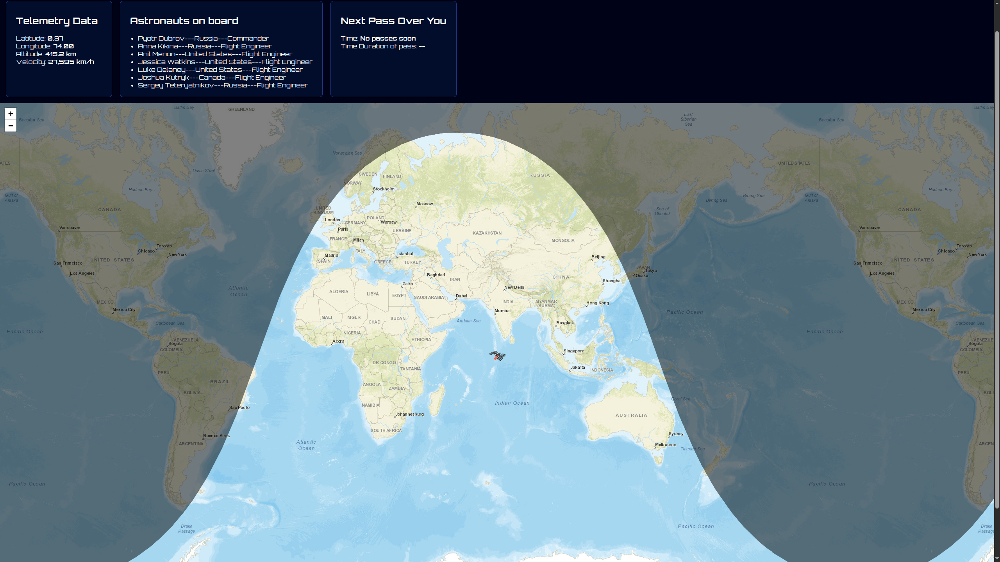

## Live-ISS-Tracker

Live ISS Tracker is a web app you can use to pinpoint the exact location of the International Space Station, at any given time. It features a minimal, sci-fi inspired interface, and can be run on most modern browsers.

# HOW THIS WAS MADE
Live ISS Tracker was made entirely from scratch, utilizing HTML, CSS, and  JavaScript logic to build this. I used VS.Code as my text editor, and am hosting the web app on Github pages.

# API's Used
Core telemetry / Backend positioning logic: [wheretheiss.at](wheretheiss.at)
    
I mainly used this for calling the location (lat and lon), altitude, and velocity of the iss every 2.5ms. This API also helped with computing the user's GPS location with the ISS's location to predict the next overhead pass based on the user.

ISS Crew API: [corquaid.github.io/.../people-in-space.json](corquaid.github.io/.../people-in-space.json)

This static JSON file contains a list of the name and details of each person currently on the ISS, or bound to be on it in the near future. I called mainly, the names, countries of origin and role on the ISS to feed back into an output the user can see, similar to the telemetry data above.

**Additional plugin information**

I used the Leaftlet Terminator client-side plugin to calculate the sun's relative position to the map, and draw a shaded polygonic region, representing parts of the world that is experiencing night time, to more accurately represent whether the ISS is in the "night" or "day". It is also used to make the map look more complete for the user.

## AI DISCLOSURE

I did use Google Gemini LLM to learn some fundamental CSS / JS concepts, and also learn how to integrate API's into my code. Gemini also helped with some basic visual formatting of the website, to prevent any positioning / scaling isues with the UI, as this is one of the first web apps I am developing from scratch.

